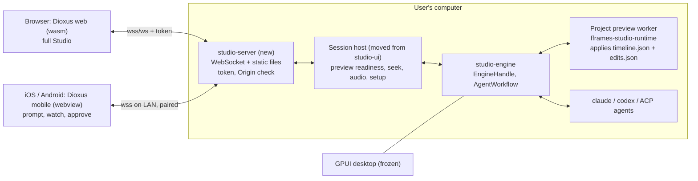

# Solution proposal: fframes Studio on the web and on phones, with Dioxus

Date: 2026-10-22. Status: proposal, nothing implemented.

## 1. The answer in short

Studio keeps its Rust engine on the user's computer and gains a small local server, `studio-server`, that
speaks a versioned WebSocket protocol. A Dioxus client, written once in Rust, runs in the browser with the
full Studio feature set and is bundled as an iOS and Android app with a smaller set: prompt the agent,
watch the preview, approve or undo changes. The GPUI desktop app is frozen; it keeps working and is not
extended.

Canvas editing becomes direct: click an object in the preview, drag, scale or rotate it with handles,
change its colour or opacity in an inspector, or type new text in place. Geometry and paint edits are
stored in a new project file, `edits.json`, that fframes applies to the frame at run time, the same way
`timeline.json` applies trims today. A drag therefore never rebuilds the project; the preview updates
within one frame request. Text edits and "make it permanent" go to the Rust source.

## 2. Decisions already made

| Question | Decision |
| --- | --- |
| Where does the engine run | On the user's computer. Agents, cargo builds and the preview worker stay local. |
| What the phone does | Prompt, watch, approve or undo, over the local network after pairing. |
| GPUI desktop app | Frozen. Its engine crates become the shared backend. |
| Client framework | Dioxus, all Rust. The phone renders in the system webview; accepted. |
| GPUI code | Frozen and used as a reference only; not refactored. The server has its own orchestration. |
| Outside the local network | Later, like T3 Code: the user's Tailscale tailnet first, a managed relay only as a design note. |
| Test devices | Android phone, Android emulator on this VM, a Mac for iOS; a firewall rule for testing is allowed. |

## 3. What exists and is reused

The scouts confirmed these facts in the repository:

- **The engine has no UI dependency.** `studio-engine`, `studio-harness`, `studio-project`, `studio-presets`,
  `studio-sdk` and `studio-bootstrap` (about 105k lines) do not use GPUI. `EngineHandle`
  (`desktop/crates/studio-engine/src/engine/handle.rs:157`) takes a `Command` and returns one
  `async_channel` stream of `EngineEvent`. There is no async runtime; the engine uses std threads.
- **Agent rows already serialize.** `Row`, `RowKind` and every card type in
  `desktop/crates/studio-engine/src/agent/model.rs` derive `Serialize`/`Deserialize`. `WorkflowSnapshot`
  itself does not.
- **The worker protocol already serializes.** `PreviewRequest`/`PreviewResponse`, `FrameHeader` and
  `EditorFrameMetadata` in `fframes-studio-protocol` are serde types.
- **Objects already have stable identities.** `fframes::EditorObjectKey` (`fframes/src/editor.rs`) encodes
  scene, component, object and repeat keys, an optional source anchor and style tokens into the SVG `id`.
  The worker reports, per frame, every annotated object's bounds, paint order, parent, anchor and tokens
  (`EditorFrameMetadata`). The project template already annotates its title.
- **Hit testing has no UI dependency.** `desktop/crates/studio-engine/src/canvas_selection.rs` (`hit_test`,
  `cycle_hit_candidates`, `revalidate_selection`) only imports `fframes_studio_protocol`. It can compile
  to WebAssembly and run in the client.
- **Runtime documents are an established pattern.** `fframes::TimingDoc` is read by `cli::new(..).timing_file`,
  `RenderOptions::timing` and `Previewer::set_timing`. The source inventory classifies `timeline.json` as
  `FileKind::Timing`, which is outside the build revision, so a timing edit never rebuilds.
- **The theme is portable.** `studio-theme` holds flat sRGB colours, pixel metrics and type sizes that were
  transcribed from Cap's CSS variables. They export to CSS custom properties directly.

What does not exist yet:

- `Command`, `EngineEvent` and `Presentation` are not serializable. They carry process handles, an
  `Arc<Mutex<Controller>>`, `ProcessTreeManager` and raw PCM. A separate data-transfer layer is needed.
- Some orchestration lives in `studio-ui` and must move to the server: preview readiness
  (`shell/engine_events.rs`), seek and timing orchestration (`shell/player.rs`), SDK install
  (`setup_view.rs`), provider registry writes (`agent/provider_setup.rs`, `agent/commands.rs`), attachment
  reads (`agent/attachment_flow.rs`) and the changes model mapping (`agent/changes/host.rs`).
- Audio plays through cpal inside the engine process (`services/audio_service.rs`). A browser or phone
  needs the samples streamed to it.

## 4. Architecture



### 4.1 Crates

| Crate | Where | Target | Role |
| --- | --- | --- | --- |
| `studio-api` | `desktop/crates/studio-api` | native and `wasm32` | Versioned protocol: client commands, server events, presentation and workflow snapshots, edits, media framing. Serde only, no tokio, no `std::fs`. |
| `studio-canvas` | `desktop/crates/studio-canvas` | native and `wasm32` | `canvas_selection.rs` moved out of the engine, plus gizmo math (handles, snapping, delta composition). The engine re-exports it. |
| `studio-server` | `desktop/crates/studio-server` | native | Session host and WebSocket server (tokio, axum, tokio-tungstenite, rustls). Serves the built web client. Binary `fframes-studio-server`. |
| `studio-web` | `desktop/clients/studio-web` | `wasm32`, iOS, Android | Dioxus 0.7.10 app. Feature flag `mobile` selects the phone subset. |

The engine keeps its threads. The server bridges them to tokio with `async_channel` and
`spawn_blocking`, so the engine needs no async rewrite.

### 4.2 Protocol

- One WebSocket per client with two kinds of messages. **Control** messages are JSON
  (`studio-api::ClientMessage` and `ServerMessage`), each with a protocol version and a request id.
  **Media** messages are binary records with a small header (kind, preview identity, frame index,
  seek serial) and a payload.
- The server pushes **snapshots, not diffs**, at first: `PresentationView`, `WorkflowView` (with
  `Arc<Row>` rows sent once and then referenced by `RowId`) and `TimelineView`. It sends a new snapshot
  when the engine reports a change. Row deltas come later if bandwidth requires them.
- Paths on the wire are project-relative wherever possible. Host paths appear only in the folder browser,
  and only inside roots the user allowed.

### 4.3 Security

The server can start agents and cargo builds, which run arbitrary code. Browsers do not apply
same-origin rules to WebSockets, so any page the user visits could connect to `ws://127.0.0.1`.

- Bind to `127.0.0.1` by default. Every connection needs a bearer token, which the server prints and
  writes to app data with user-only permissions. Opening the web UI from the server's own URL passes the
  token in the URL fragment, never in the query string.
- Reject any `Origin` that is not the server's own origin or a configured development origin.
- LAN access for phones is opt-in in **Settings → Remote devices**. Pairing shows a one-time code, the
  address and the certificate fingerprint, and a QR code with the same data. Typing the code is the
  baseline; scanning is optional because camera access inside the webview is unproven. The server then
  listens on the LAN with TLS and a self-signed certificate. Devices can be revoked.
- **Pinning on the phone is a known problem.** JavaScript in a webview cannot pin a certificate, and a
  `wss://` connection to a self-signed server fails unless native code overrides trust; Dioxus has no
  hook for that. The Rust side of a Dioxus mobile app runs natively, so control messages use
  tokio-tungstenite with a rustls verifier that pins the fingerprint. Frames and audio must reach
  JavaScript (WebCodecs, AudioWorklet) without going through `eval`. Two candidate bridges: an in-app
  relay on the phone's loopback that the webview reads from, or a custom-protocol handler in the
  webview that Rust feeds. Spike S4 decides which one works.
- Permission prompts behave exactly as on desktop. A phone can answer them; "Allow everything" stays a
  local setting that a remote client cannot turn on.

### 4.4 Media: frames and audio

- **Scrub and still frames.** The server encodes the worker's RGBA frame as JPEG at the client's view
  size (WebP if the spike shows it is cheaper) and sends it with its `EditorFrameMetadata`. The client
  decodes it with `createImageBitmap` and draws it on a `<canvas>`. The newest seek wins; older requests
  are dropped on both sides.
- **Playback.** The server encodes the frame sequence to H.264 with the FFmpeg that fframes already
  links, at the view size, and streams encoded chunks. The client decodes them with WebCodecs
  `VideoDecoder`. If WebCodecs is missing (some Android webviews), playback falls back to JPEG frames
  at reduced rate.
- **Audio.** The server sends the prepared mix as 48 kHz PCM chunks. The client plays them through an
  `AudioWorklet` ring buffer, and the audio clock drives which video frame is shown. Mute and output
  device choice become client-side. `AudioService` stays for the GPUI app.
- On loopback the server may send raw RGBA instead of JPEG; the spike decides whether that is faster.
- Encoding costs CPU on the computer, which on this machine is the same CPU the renderer uses. The spike
  measures encode cost and checks which H.264 encoder the managed SDK's FFmpeg actually contains.
- On the phone, frames and audio take the bridge described in 4.3, not the plain WebSocket.

## 5. Canvas editing

### 5.1 What the user can do

1. **Select.** Click an object in the preview. The client hit-tests the current frame's metadata
   (`studio-canvas::hit_test`) with no round trip. **C** cycles through overlapping objects, Shift-drag
   selects a rectangle, Escape clears. This is today's behaviour, now in the browser.
2. **Move, scale, rotate.** The selection shows a box with eight scale handles and a rotate handle.
   Dragging shows a ghost outline immediately in the client, and the server renders low-resolution
   frames of the real result at up to 30 per second. Release writes `edits.json` once and records one
   undo step. Shift keeps proportions, Alt scales from the centre, and snapping uses the canvas centre,
   edges and other objects' bounds.
3. **Inspect and adjust.** An inspector panel shows the override values (move X/Y, scale X/Y,
   rotation, opacity, fill, stroke) as editable fields, and the resulting bounds read-only, plus the
   style tokens the object declares. Number fields support drag-to-scrub.
   Ctrl+Z follows the focused surface: on the stage and inspector it undoes canvas edits, on the
   timeline it undoes timing edits; elsewhere in the window it undoes whichever of the two changed last.
4. **Edit text in place.** Double-click a text object to open an input over it. Commit writes the new
   text to the Rust source (see 5.4) and triggers a build.
5. **Choose the scope.** A switch beside the inspector sets **Whole clip** (one offset for the object's
   lifetime) or **Keyframe at playhead** (adds a keyframe; between keyframes values interpolate with the
   chosen easing). For repeated objects (same component and object key, different `repeat_key`), the
   switch offers **This one** or **All copies**.
6. **Make it permanent.** **Bake into source** turns the selected object's overrides into Rust code
   through a scoped agent task with the overrides as structured context, then clears them from
   `edits.json` once the build is accepted.

### 5.2 The edits document

`edits.json`, beside `timeline.json`, version 1:

```json
{ "version": 1, "objects": [
  { "key": { "scene": "intro", "component": "starter-title", "object": "headline", "repeat": "primary" },
    "scope": "clip",
    "translate": [120.0, -40.0], "scale": [1.1, 1.1], "rotate": 0.0, "origin": "center",
    "opacity": 0.9, "fill": "#ffcc00" },
  { "key": { "scene": "intro", "component": "logo", "object": "mark", "repeat": "*" },
    "scope": "keyframes",
    "keyframes": [ { "frame": 30, "translate": [0, 0], "easing": "ease_out" },
                   { "frame": 60, "translate": [200, 0] } ] } ] }
```

Rules:

- Values are **deltas** composed after the object's own transform and opacity, so an animation the code
  produces keeps playing and an agent's later source change still works underneath the edit. Colour
  overrides replace the paint.
- Keys follow `EditorObjectKey`. `"repeat": "*"` matches every copy.
- Keyframe frames are relative to the scene start, like scene frame numbers, so trims and reordering in
  `timeline.json` do not shift them.
- Keys that match no object in a frame are ignored and listed by `inspect`. An invalid document is
  rejected as a whole with the reason, as `TimingDoc` is.

### 5.3 Where it is applied

- `fframes` core gains `EditDoc` next to `TimingDoc`: `RenderOptions::edits`, `cli::new(..).edits_file("edits.json")`
  and `Previewer::set_edits`. The CLI `render`, the Studio worker and Studio export therefore draw the
  same picture. A video that never opts in is unchanged.
- After `render_frame` returns, and **before** the `Svgr` is converted to a `usvgr::Tree`, fframes finds
  annotated nodes by their render id in the `Svgr` nested tree and wraps each one in a new group
  carrying the extra transform and opacity. (After conversion is not possible: `usvgr` keeps
  `static_hash` crate-private and has no mutation API.) A wrapper group has no
  static hash, so transform and opacity overrides never meet a stale cache entry.
- An annotated node has an interpolated `id`, so it is never itself inside a static subtree. Its
  children can be static and cached by `static_hash`. A fill or stroke override therefore clears the
  static identity of every descendant it repaints, so the Skia picture and paint caches and the CPU path
  cache do not reuse old pixels. The spike proves this on the CPU and Skia CPU backends.
- The edits are applied **before** the worker collects `EditorFrameMetadata`
  (`fframes-studio-runtime/src/preview_worker.rs` around line 160), so reported bounds include the edit
  and the selection box follows the object after a drag.
- `edits.json` gets a new `FileKind::Edits` that, like `FileKind::Timing`, is part of the source revision
  but not of the build revision. An edit never rebuilds, and the current export binding stays valid.
- The engine gets an edits session modelled on the timing session (`controller/timing.rs`): gesture
  bracketing, one atomic staged write per gesture, snapshot undo and redo, refusal while an agent task
  runs, reload with a notice when the file changes outside Studio.

### 5.4 Text and permanent changes go to source

Text layout (`text_fit`, `text_break_lines`) runs inside `render_frame`, before the tree exists. Replacing
text after layout would break wrapping and ellipsis, so text never goes through `edits.json`.

- Today's anchors point at rendering code, not at the text (the template's headlines are passed into
  `TitleScene::new` elsewhere). Spike S6 tests a text marker convention: a `// studio-text: <key>`
  comment before the literal that supplies the text. The server resolves it at edit time, finds exactly
  one string literal with `syn`, records the file hash and byte span, rewrites the literal in a durable
  edit transaction and builds. A changed file or an ambiguous marker refuses the edit.
- Otherwise the text change becomes a scoped agent task ("change the headline to …") with the selection
  attached.

### 5.5 Limits the user will see

- Only **annotated** objects can be selected or edited. New projects from the template annotate their
  objects; imported projects show "This frame has no editable objects" until the code registers
  `EditorObjectKey`s. The agent's `AGENTS.md` is updated to annotate new objects by default.
- Editing on the phone is out of scope. The phone shows the preview only.
- The authority table changes: Rust source is the authority, **plus** `timeline.json` for timing and
  `edits.json` for canvas overrides. Both the docs and the generated `AGENTS.md` say so, so an agent
  does not undo a user's drag by accident.

## 6. Features by client

| Feature | Web | Phone |
| --- | --- | --- |
| Agent chat, composer (steer, send at boundary, send now), plan, questions | Yes | Yes |
| Permission cards | Yes | Yes |
| Changes: file list, diffs, Apply, Revert file, Undo last edit | Yes | Yes (unified diff only) |
| Preview: play, pause, step, scrub, audio | Yes | Yes |
| Session history and search | Yes | Yes (list and resume) |
| Canvas select, move, scale, rotate, inspector, in-place text, bake | Yes | No |
| Timeline: split, trim, move, range select, waveform, minimap | Yes | No (read-only ruler) |
| Create, open, import, locate projects (server folder browser) | Yes | Open recent only |
| Assets: upload, list | Yes | No |
| Presets and style tokens | Yes | No |
| Export with progress and cancel (file saved on the computer, download offered) | Yes | Start and watch only |
| SDK setup, agent setup, settings, onboarding | Yes | No |
| Remote devices: pairing, revoke | Yes | Pair only |
| Keyboard map | Yes | No |

## 7. Framework findings and their consequences

From `plans/reports/researcher-261022-2044-dioxus-web-mobile.md`:

- **Pin Dioxus 0.7.10** (stable, 2026-07-30). 0.8 is in alpha with breaking changes. Plan one migration
  when 0.8 is stable.
- **Dioxus mobile renders in the system webview** (WKWebView, Android System WebView), not natively. The
  experimental native renderer (Blitz) is not usable for this app. Performance-critical drawing (frames,
  timeline, waveform, gizmos) therefore goes to `<canvas>` through `web-sys`, and heavy work (SVG
  rendering, encoding, waveform peaks, markdown and diff parsing) stays in Rust on the server or in WASM.
- **No first-party virtual list.** Studio needs a small windowed list for transcripts, history and diffs.
- **Use our own WebSocket transport.** Dioxus fullstack websockets are same-origin and assume its own
  server. Use `gloo-net` in WASM and `tokio-tungstenite` with rustls on the native side, behind one trait
  in `studio-api`.
- **Mobile bundling is thin.** `dx` produces `.apk` and `.app`; there is no documented `.aab` or signing
  flow. Store release is not part of this plan.
- **Android 0.7.x may blank the webview** after a dark mode or font scale change. It is fixed in
  0.8-alpha.3. It has to be tested on a device.

## 8. Risks

| Risk | Effect | Mitigation |
| --- | --- | --- |
| Webview performance on phones | Janky preview | Encoded frames, WebCodecs, canvas drawing; phone scope is small |
| Patched objects inside cached static subtrees draw stale | Wrong preview or export | Wrapper groups, cleared identity on patched nodes, spike on CPU and Skia |
| Local server reachable by websites | Code execution through the agent | Token, Origin check, loopback default, paired TLS for LAN |
| Plain `ws://` blocked on iOS (ATS) and Android (cleartext policy); webview JS cannot pin a self-signed certificate | Phone cannot connect or cannot stream media | Native Rust control connection with pinning; media bridge chosen by spike S4 |
| Safari and GPU Skia cannot be tested on this Windows VM | Unverified | Reported as unverified |
| iOS cannot be built or verified on this Windows machine | iOS unverified | Android verified here; iOS needs a Mac and is reported as unverified |
| Dioxus breaking changes | Migration cost | Pin 0.7.10, keep UI logic in plain Rust modules |
| Orchestration exists twice (GPUI and server) | Fixes must be made in both while GPUI lives | GPUI is frozen and only takes critical fixes; the server port keeps the existing tests |

## 9. Remote access beyond the local network

Following T3 Code, which pairs phones by one-time code or QR, publishes over the user's tailnet with
`t3 pair --tailscale`, and offers a hosted relay (T3 Connect) for a public URL
([remote access docs, mirror](https://ithub.global.ssl.fastly.net/Type-Delta/t3code/blob/main/docs/user/remote-access.md),
[DeepWiki summary](https://deepwiki.com/pingdotgg/t3code/7-cloud-and-remote-access)). Phase 10 adds a
Tailscale route: Studio publishes the server with `tailscale serve`, which gives an HTTPS address with a
certificate Tailscale issues, so that route needs no self-signed pinning. A managed relay requires a
service the project would run and pay for, so it is only designed, not built.

## 10. Questions (answered 2026-10-23, kept for the record)

1. **Webview, not native.** Your criterion was "native, fastest with large elements and SVG". Dioxus
   draws its UI in a webview on phones. The heavy SVG rendering stays in the Rust worker either way, and
   the plan draws frames, timeline and gizmos on a canvas. Is that acceptable, or should the phone app
   use a different toolkit?
2. **Moving logic out of `studio-ui`.** Either refactor the frozen GPUI app to call the new session host
   (one shared implementation, requires re-verifying the desktop app on Windows), or leave GPUI untouched
   and keep two copies of that orchestration. Which do you want?
3. **Reaching the computer from outside the home network.** The plan covers the local network only. Do
   you also want a tunnel (for example a relay or Tailscale)?
4. **iOS.** Building and testing iOS needs macOS and Xcode. Is a Mac available, or is Android enough for
   the first release?
5. **Android testing.** Is there an Android phone, or should an emulator run on this VM? Testing a phone
   over the LAN needs an inbound firewall rule on this machine, which is a network change.
